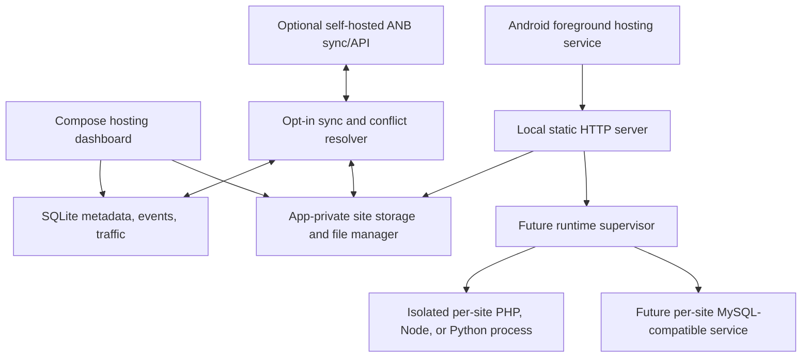

# ANB Hosting audit and development roadmap

## Snapshot

This audit describes the local `main` worktree as of 2026-11-16. The GitHub `main` branch was still at `e074683` when checked, so local Android changes have not yet run in GitHub Actions. The Android package ID remains `com.anbhosting.app`.

“Added” means the implementation is present in source. It does not imply that the new Android code has passed its CI tests or a real-device check.

## Added in source

- NestJS email/password signup and login, Argon2id password hashing, JWT session cookies, CSRF checks, tenant-scoped API queries, and an initial admin membership role with role guards.
- PostgreSQL and Prisma models for users, tenants, memberships, websites, domains, and audit logs.
- A tenant-scoped website API with create, list, start, stop, restart, delete, and status operations.
- A Next.js dashboard with account, website, overview and activity views, plus a PWA app shell that does not cache API credentials or account data.
- Android login/signup against the existing API, workspace overview, website list, and website lifecycle actions.
- Android offline static hosting source: app-private website folders, an on-device SQLite catalog, localhost preview, optional read-only Wi-Fi access, a visible foreground service, and restart-on-next-app-launch recovery for sites left active.
- Android local virtual-host source: every saved site's `<slug>.localhost` hostname routes to that active site's root for offline phone preview over IPv4/IPv6 loopback; Wi-Fi sharing keeps the existing phone-IP/path URL.
- Configurable Android partial CPU wake lock while active sites run, with an in-app battery setting and a shortcut to Android app battery settings.
- Android local website management source: SAF file import/export, delete/rename, small text-file editing, ZIP extraction, and ZIP backup/restore.
- Android local request/error events, per-site file/storage totals, 30-day successful response payload totals, app memory/CPU samples, and free-storage samples.
- Android public GitHub repository deployment source: select a branch, tag, or commit (or use the default), resolve it to a commit SHA, deploy to a new or stopped existing site, and roll back up to three saved file snapshots capped at 50 MiB each. ZIP and path limits are enforced; no build is run.
- GitHub Actions source for JavaScript workspace validation and an Android debug unit-test/APK build. The Android job runs `:app:testDebugUnitTest` before `:app:assembleDebug`.
- Optional signed Android release build source: the app version is `2` with the same `com.anbhosting.app` ID, and CI can sign only when the existing key is supplied through four GitHub secrets; no key is configured yet.
- A Docker-based static-site engine and NGINX routing for a separate Linux host. The Docker site container has fixed CPU, memory, PID, capability, filesystem, and log limits.
- A script for private-CA HTTPS on the Linux-hosted LAN stack. Android trusts installed user CA certificates for API connections.

## Partially added

- **Android local hosting:** only static `GET` and `HEAD` are served. Phone preview and Wi-Fi sharing currently use HTTP; TLS is configured for the separate Docker/Nginx LAN host. A foreground service, configurable CPU wake lock, and relaunch recovery exist, but Doze, battery saver, OEM policies, or force-stop can still interrupt hosting; there is no boot-time recovery.
- **Website management:** file operations are local to Android app-private sites. The Docker-hosted website API still has no customer file upload, editor, archive, backup, or restore endpoints.
- **Roles and workspaces:** tenant isolation and an initial admin/user role foundation exist; there is no complete member invitation, role-management, or account administration workflow.
- **Domains and SSL:** the Android phone-local `<site-slug>.localhost` alias is source-implemented for offline preview. The Android resolver returned both `::1` and `127.0.0.1`, and a loopback HTTP request to a temporary test server succeeded through that hostname. The alias is not reachable from other devices. The Prisma `Domain` model and Linux local-CA setup exist, but there is no Android domain management/API, DNS ownership verification, registrar/provider integration, TLS on the phone, public certificate issuance, or automatic renewal.
- **Database support:** PostgreSQL stores ANB control-plane data. It is not a customer database feature and there is no MySQL-compatible server, per-site database/user management, import/export, or backup workflow.
- **Monitoring and limits:** Android now has local app/storage measurements and site request totals. It does not enforce per-site CPU/RAM/storage quotas. The Docker engine has container limits, but dashboard storage/bandwidth metrics are not wired to measured production data.
- **GitHub deployment:** public prebuilt static-folder deployment with branch/tag selection, commit-SHA pinning, stopped-site updates, and a three-snapshot local rollback history (50 MiB per backup) is implemented in source. Private-repository authorization, source builds, and cloud deployment history remain missing.
- **Dashboard parity:** the web dashboard and Android app provide the existing account/website workflows. Android does not yet have complete domains, databases, email, deployment, or hosting-plan modules; the UI is not yet a finished premium hosting console.
- **APK updates:** the application ID is stable and an optional signed release path is source-configured, but the repository has no stable release/upload key configured. CI currently produces only debug APKs; package ID alone does not make separately signed APKs update-compatible.

## Missing

- Packaged, on-device PHP, Node.js, and Python runtimes, runtime version selection, per-site process controls, and useful build/runtime logs.
- A real MySQL-compatible customer database service inside Android, with isolated databases/users, credentials, import/export, and backup/restore.
- Private GitHub repository authorization, on-device build steps, full build/deploy history, and cloud deployment history.
- Custom-domain/subdomain management, DNS configuration and verification, public Let's Encrypt issuance, and renewal.
- Optional synchronization to a self-hosted ANB endpoint, with conflict handling and user-controlled data scope.
- Functional Android modules for domains, databases, and email services, and complete web/mobile feature parity.
- Hosting plans/billing and an internet-reachable public hosting deployment. No public hosting should be exposed until real server capacity, DNS, ingress, TLS, operations, and abuse controls exist.

## Not yet tested

- Android unit tests added for static serving, path safety, file/archive operations, database migration, resource measurement, public-repository URL/ref validation, branch-to-SHA resolution, pinned archive deployment, rollback, failure cleanup, folder selection, dotfile protection, and the screen-off preference have not run in GitHub Actions for the local commits.
- The wake-lock acquire/release lifecycle has not been exercised on a physical Android device.
- The new `<site-slug>.localhost` Host routing and IPv4/IPv6 listener behavior have not run in Android CI; browser preview has not been verified on a physical phone.
- Version 2, the Gradle release-signing configuration, and the optional signed-release CI step have not run in GitHub Actions. The actual release signing key remains unidentified.
- No APK has been built from the local commits after `e074683`, installed, or tested on an Android device. The available shells have no JDK or Gradle. The requirement to build Android APKs through GitHub Actions remains in force.
- The latest observed GitHub Actions run was run 5 for remote commit `e074683`; it succeeded. That verifies the old remote revision, not any commits currently ahead of `origin/main`.
- GitHub Actions could not be triggered for the local commits because GitHub write credentials are not configured in this workspace.
- No full Docker Compose, NGINX, DNS, ACME, GitHub deployment, or live multi-device hosting test was performed in this audit.
- The monorepo lint, formatting, typecheck, and JavaScript test commands passed locally. API tests: 2 passed; hosting-engine tests: 2 passed. `npm run build` could not finish on Android because Next.js requested a nonexistent `@next/swc-android-arm64` binary. This device limitation is not an Android CI build result.

## Target architecture

The current Android path is the SQLite/store, file manager, foreground service, and static HTTP server. Runtime and database boxes are future work. The first runtime design is a proposal, not implemented code: the foreground supervisor owns the listener, while an Android isolated worker handles dynamic site code over a narrow IPC contract. A file broker would grant operations only within that site's root, and the worker would not receive the app's account/session data. Android documents isolated services as having no permissions of their own and communicating through the Service API; the Python package must also be proven loadable from that process. Before enabling dynamic code, demonstrate request/response streaming, path-scoped file access, process termination/recovery, and enforceable resource limits on an actual device.

The existing web/cloud path remains separate: web or Android client → LAN NGINX/API → PostgreSQL and the private hosting engine → static Docker site container. This stack runs on an external Linux host; it is not the Android-local server.

## Phase-wise roadmap

### Phase 1 — Stabilize offline static hosting

- Run the Android CI tests and debug APK build for all local commits after `e074683`; fix every compile/test failure.
- Exercise create/start/preview/stop, Wi-Fi rebind, notification denial, process death/relaunch, archive safety, backup restore, and storage accounting on Android devices.
- Improve foreground-service and battery guidance using supported Android APIs, while showing when the OS has stopped hosting.
- Verify CPU wake-lock acquisition/release on supported Android versions and measure screen-off serving, battery use, Doze behavior, and user battery-setting changes across device vendors.
- Keep local HTTP sharing off by default and clearly distinguish phone HTTP preview from the separate LAN host's HTTPS setup.

### Phase 2 — Runtime foundation and Python feasibility

- Define a per-site runtime contract for install/version, start/stop/restart, health, logs, and enforceable resource limits.
- Prototype CPython first for `arm64-v8a`, using CPython's Android embedding build and `libpython`; Android does not provide a system Python installation or standalone Python console. Build and package the interpreter, standard library, and app code through GitHub Actions.
- Keep the Kotlin HTTP server as the listener and route Python requests through an explicit worker IPC contract. The runtime worker must not receive ANB session credentials or unrestricted access to other sites.
- Prove worker isolation, scoped file access, request body/response streaming, process recovery, and bounded CPU/memory/storage before adding a runtime selector or running imported Python code.
- Add Python selection only after the packaged runtime, a real HTTP app, lifecycle, useful logs, stop/restart, and device tests pass together.

### Phase 3 — Node.js and PHP feasibility

- Evaluate each runtime against the same package, IPC, isolation, storage, battery, ABI, and release-size gates before promising support.
- Node.js documents Android as unsupported and says it has no Android testing in its current CI. PHP's installation manual says cross-compiling with the Android toolchain is currently unsupported. Treat both as downstream porting projects, not routine runtime packaging.
- Build candidate artifacts only in GitHub Actions, run upstream/runtime smoke tests where available, and test on supported Android devices. Do not download interpreters when a site starts.
- Expose a runtime/version only after its actual Android artifact, per-site lifecycle, logs, limits, restart behavior, and file isolation work end to end.

### Phase 4 — MySQL-compatible databases

- Prove a bundled Android-compatible MySQL/MariaDB server can run within phone storage, RAM, CPU, and battery limits.
- Keep database sockets private to the phone; add per-site database/user creation, credential rotation, import/export, backup/restore, quotas, and logs.
- If a safe, maintainable Android server cannot be shipped, expose the limitation instead of labeling SQLite as MySQL.

### Phase 5 — GitHub deployment and build history

- Add release builds, a full deployment timeline, and cloud deployment history to the implemented public prebuilt-static deployment.
- Add private repositories only with a proper OAuth/app authorization flow.
- Build using supported on-device runtimes, stage releases atomically, and keep detailed build/deploy logs and rollback history.
- Do not store personal access tokens in logs or plain-text preferences.

### Phase 6 — Domains and certificates

- Implement real domain records, host routing, ownership challenges, and DNS verification with documented provider adapters.
- For phone-only local hosting, provide local-network naming/private certificate options and explain that public DNS cannot route through carrier NAT or a private Wi-Fi address.
- Add Let's Encrypt issuance and renewal only for a deployment with working public ingress or a configured DNS-01 provider and securely stored credentials.

### Phase 7 — Dashboard parity and optional sync

- Add mobile and web screens only alongside working APIs for files, runtimes, databases, domains, logs, and emails.
- Add opt-in sync to a self-hosted ANB endpoint with per-category selection, encryption in transit, conflict handling, resumable transfers, and offline-first behavior.
- Add resource plans/billing only when the product has a real metering and billing service.

### Phase 8 — Public hosting readiness

- Require actual internet-reachable infrastructure, durable storage, DNS, ingress, certificate automation, tenant isolation, monitoring, backups, incident response, and abuse controls.
- Until those prerequisites exist, keep public hosting unavailable and continue to target offline phone hosting plus the user's self-managed LAN server.

## Release compatibility gate

Before publishing an update APK, identify the signing key used by the existing installed/released app. Store it only in GitHub Actions secrets and build a signed release using that key. If no prior release key exists, create and back it up before first release. A new debug key or a different signing key will not update an app installed with the old signature.

## Runtime feasibility references

- CPython Android embedding and packaging: <https://docs.python.org/3.14/using/android.html> and <https://github.com/python/cpython/blob/3.14/Android/README.md>.
- Node.js Android build/support status: <https://github.com/nodejs/node/blob/main/BUILDING.md#android>.
- PHP Android toolchain cross-compilation status: <https://www.php.net/manual/en/install.unix.source.php>.
- Android isolated service process model: <https://developer.android.com/guide/topics/manifest/service-element#isolated_process>.
- Reserved `.localhost` hostname behavior: <https://www.rfc-editor.org/rfc/rfc6761.html#section-6.3>.
