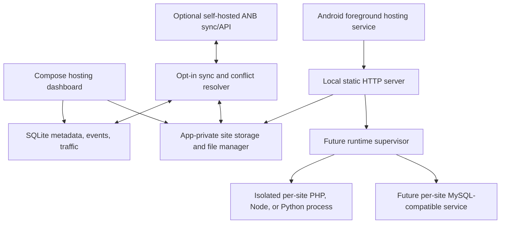

# ANB Hosting audit and development roadmap

## Snapshot

This audit describes local branch `main` at `58b968e`. The GitHub `main` branch was still at `e074683` when checked, so the Android commits listed below have not yet run in GitHub Actions. The Android package ID remains `com.anbhosting.app`.

“Added” means the implementation is present in source. It does not imply that the new Android code has passed its CI tests or a real-device check.

## Added in source

- NestJS email/password signup and login, Argon2id password hashing, JWT session cookies, CSRF checks, tenant-scoped API queries, and an initial admin membership role with role guards.
- PostgreSQL and Prisma models for users, tenants, memberships, websites, domains, and audit logs.
- A tenant-scoped website API with create, list, start, stop, restart, delete, and status operations.
- A Next.js dashboard with account, website, overview and activity views, plus a PWA app shell that does not cache API credentials or account data.
- Android login/signup against the existing API, workspace overview, website list, and website lifecycle actions.
- Android offline static hosting source: app-private website folders, an on-device SQLite catalog, localhost preview, optional read-only Wi-Fi access, a visible foreground service, and restart-on-next-app-launch recovery for sites left active.
- Android local website management source: SAF file import/export, delete/rename, small text-file editing, ZIP extraction, and ZIP backup/restore.
- Android local request/error events, per-site file/storage totals, 30-day successful response payload totals, app memory/CPU samples, and free-storage samples.
- GitHub Actions source for JavaScript workspace validation and an Android debug unit-test/APK build. The Android job runs `:app:testDebugUnitTest` before `:app:assembleDebug`.
- A Docker-based static-site engine and NGINX routing for a separate Linux host. The Docker site container has fixed CPU, memory, PID, capability, filesystem, and log limits.
- A script for private-CA HTTPS on the Linux-hosted LAN stack. Android trusts installed user CA certificates for API connections.

## Partially added

- **Android local hosting:** only static `GET` and `HEAD` are served. Phone preview and Wi-Fi sharing currently use HTTP; TLS is configured for the separate Docker/Nginx LAN host. A foreground service and lifecycle recovery exist, but Android may restrict or kill long-running services and there is no boot-time recovery or OEM-specific battery handling.
- **Website management:** file operations are local to Android app-private sites. The Docker-hosted website API still has no customer file upload, editor, archive, backup, or restore endpoints.
- **Roles and workspaces:** tenant isolation and an initial admin/user role foundation exist; there is no complete member invitation, role-management, or account administration workflow.
- **Domains and SSL:** the Prisma `Domain` model and Linux local-CA setup exist. There is no domain API/UI, DNS ownership verification, registrar/provider integration, public certificate issuance, or automatic renewal.
- **Database support:** PostgreSQL stores ANB control-plane data. It is not a customer database feature and there is no MySQL-compatible server, per-site database/user management, import/export, or backup workflow.
- **Monitoring and limits:** Android now has local app/storage measurements and site request totals. It does not enforce per-site CPU/RAM/storage quotas. The Docker engine has container limits, but dashboard storage/bandwidth metrics are not wired to measured production data.
- **Dashboard parity:** the web dashboard and Android app provide the existing account/website workflows. Android does not yet have complete domains, databases, email, deployment, or hosting-plan modules; the UI is not yet a finished premium hosting console.
- **APK updates:** the application ID is stable, but CI currently creates debug APKs and the repository has no stable release/upload key. Package ID alone does not make separately signed APKs update-compatible.

## Missing

- Packaged, on-device PHP, Node.js, and Python runtimes, runtime version selection, per-site process controls, and useful build/runtime logs.
- A real MySQL-compatible customer database service inside Android, with isolated databases/users, credentials, import/export, and backup/restore.
- Public or private GitHub repository deployment, build steps, deployment logs, and rollback.
- Custom-domain/subdomain management, DNS configuration and verification, public Let's Encrypt issuance, and renewal.
- Optional synchronization to a self-hosted ANB endpoint, with conflict handling and user-controlled data scope.
- Functional Android modules for domains, databases, and email services, and complete web/mobile feature parity.
- Hosting plans/billing and an internet-reachable public hosting deployment. No public hosting should be exposed until real server capacity, DNS, ingress, TLS, operations, and abuse controls exist.

## Not yet tested

- Android unit tests added for static serving, path safety, file/archive operations, database migration, and resource measurement have not run in GitHub Actions for the local commits.
- No APK has been built from local commit `58b968e`, installed, or tested on an Android device. This shell has no JDK or Gradle. The requirement to build Android APKs through GitHub Actions remains in force.
- The latest observed GitHub Actions run was run 5 for remote commit `e074683`; it succeeded. That verifies the old remote revision, not local commits `f15579d`, `7d2bc67`, or `58b968e`.
- No full Docker Compose, NGINX, DNS, ACME, GitHub deployment, or live multi-device hosting test was performed in this audit.
- The monorepo lint, formatting, typecheck, and JavaScript test commands passed locally. API tests: 2 passed; hosting-engine tests: 2 passed. `npm run build` could not finish on Android because Next.js requested a nonexistent `@next/swc-android-arm64` binary. This device limitation is not an Android CI build result.

## Target architecture

The current Android path is the SQLite/store, file manager, foreground service, and static HTTP server. Runtime and database boxes are future work. Runtime processes must not execute arbitrary customer code with unrestricted access to ANB credentials or other sites. The design phase must prove an Android-compatible isolation boundary, process/resource limits, and safe local IPC before enabling dynamic code.

The existing web/cloud path remains separate: web or Android client → LAN NGINX/API → PostgreSQL and the private hosting engine → static Docker site container. This stack runs on an external Linux host; it is not the Android-local server.

## Phase-wise roadmap

### Phase 1 — Stabilize offline static hosting

- Run the new Android CI tests and debug APK build for the three local commits; fix every compile/test failure.
- Exercise create/start/preview/stop, Wi-Fi rebind, notification denial, process death/relaunch, archive safety, backup restore, and storage accounting on Android devices.
- Improve foreground-service and battery guidance using supported Android APIs, while showing when the OS has stopped hosting.
- Keep local HTTP sharing off by default and clearly distinguish phone HTTP preview from the separate LAN host's HTTPS setup.

### Phase 2 — Runtime foundation and PHP

- Define a per-site runtime interface for install/version, start/stop/restart, health, logs, and resource limits.
- Build Android ARM64 runtime artifacts in GitHub Actions; do not require Termux or fetch a third-party hosting backend at runtime.
- Prototype PHP first behind an isolated process boundary and local IPC. Validate PHP requests and file access cannot read other sites, ANB credentials, or app-private control data.
- Add runtime selection only after installation, lifecycle, logs, limits, upgrade, and recovery work end to end.

### Phase 3 — Node.js and Python

- Add packaged Android-compatible runtimes using the same lifecycle contract and isolation checks.
- Support version selection, per-site entry points, dependency/build logs, graceful restarts, and limits.
- Verify the exact runtime artifacts and supported Android ABIs in GitHub Actions and on devices.

### Phase 4 — MySQL-compatible databases

- Prove a bundled Android-compatible MySQL/MariaDB server can run within phone storage, RAM, CPU, and battery limits.
- Keep database sockets private to the phone; add per-site database/user creation, credential rotation, import/export, backup/restore, quotas, and logs.
- If a safe, maintainable Android server cannot be shipped, expose the limitation instead of labeling SQLite as MySQL.

### Phase 5 — GitHub deployment and build history

- Start with explicit deployments from public GitHub repositories; add private repositories only with a proper OAuth/app authorization flow.
- Download and validate source archives safely, build using supported on-device runtimes, stage releases atomically, and keep build/deploy logs and rollback history.
- Do not store personal access tokens in logs or plain-text preferences.

### Phase 6 — Domains and certificates

- Implement real domain records, host routing, ownership challenges, and DNS verification with documented provider adapters.
- For phone-only local hosting, provide local-network naming/private certificate options and explain that public DNS cannot route through carrier NAT or a private Wi-Fi address.
- Add Let's Encrypt issuance and renewal only for a deployment with working public ingress or a configured DNS-01 provider and securely stored credentials.

### Phase 7 — Dashboard parity and optional sync

- Add mobile and web screens only alongside working APIs for files, runtimes, databases, domains, logs, and emails.
- Add opt-in sync to a self-hosted ANB endpoint with per-category selection, encryption in transit, conflict handling, resumable transfers, and offline-first behavior.
- Add resource plans/billing only when the product has a real metering and billing service.

### Phase 8 — Public hosting readiness

- Require actual internet-reachable infrastructure, durable storage, DNS, ingress, certificate automation, tenant isolation, monitoring, backups, incident response, and abuse controls.
- Until those prerequisites exist, keep public hosting unavailable and continue to target offline phone hosting plus the user's self-managed LAN server.

## Release compatibility gate

Before publishing an update APK, identify the signing key used by the existing installed/released app. Store it only in GitHub Actions secrets and build a signed release using that key. If no prior release key exists, create and back it up before first release. A new debug key or a different signing key will not update an app installed with the old signature.
